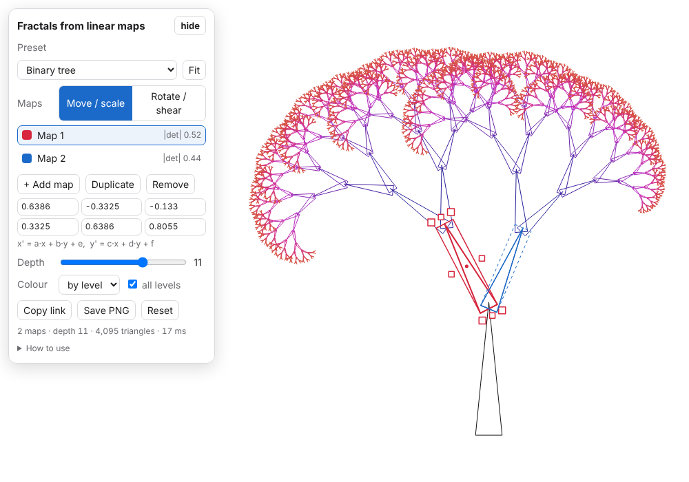

# Fractals from linear mappings

An interactive designer for fractals built from iterated affine maps, in a single
self-contained HTML file. Live version: **https://torrilhon.github.io/fractals/**

## Idea

A thin seed triangle is drawn, then every map is applied to it, then every map is applied
to each of those copies, and so on down to a chosen depth. Two or more contracting maps
produce the familiar fractal trees, dragons and ferns; the presets cover the classics.

## Using it

* Open `index.html` in any browser, offline is fine. There are no dependencies.
* Each coloured outline in the drawing is one map applied to the black seed triangle.
  Tap an outline to select it, drag inside to move it.
* **Move / scale** mode: corner handles scale uniformly (hold Shift for free scaling),
  edge handles stretch one axis.
* **Rotate / shear** mode: corner handles rotate about the centre (Shift snaps to 15°),
  edge handles shear. Tapping a selected map toggles the mode.
* Add, duplicate and remove maps in the panel, or type the matrix entries directly.
* Drag empty space to pan, use the mouse wheel or pinch to zoom, press *Fit* to frame the drawing.
* The address bar always holds a link that reproduces the current figure. *Save PNG* exports the drawing.

## Publishing

The workflow in `.github/workflows/pages.yml` deploys the repository root to GitHub Pages on
every push to `main`. In the repository settings under *Pages*, set *Source* to *GitHub Actions* once.

## History

The `legacy/` folder holds the original 1998 Borland C++ Builder program this is based on.
